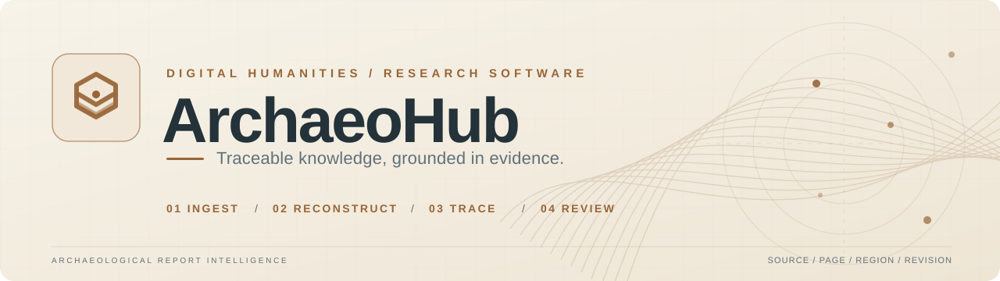
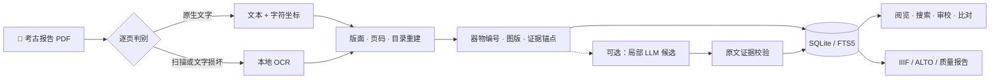

<a id="top"></a>

<div align="center">

<picture>
  <source media="(prefers-color-scheme: dark)" srcset="./assets/archaeohub-dark.svg">
  <source media="(prefers-color-scheme: light)" srcset="./assets/archaeohub-light.svg">
  
</picture>

<br>

### 面向考古报告的证据可溯源智能解析与知识组织系统

**让报告可阅读，让器物可关联，让每一项知识都有据可查。**

<p>
  
  
  
  
  
</p>

**[项目概览](#overview)** · **[核心能力](#features)** · **[处理流程](#workflow)** · **[快速开始](#quickstart)** · **[开发状态](#status)** · **[技术文档](#docs)**

</div>

---

<a id="overview"></a>

## 01 / 从考古文献到可验证的知识

考古报告承载着地层、遗迹、器物、测量数据、图版与发掘解释，但它们常散落在数百页 PDF、扫描图像和多卷目录中。研究者需要反复翻页、比对编号、核查图文来源。

**ArchaeoHub** 是一个本地优先的考古文献数字工作台，将 **PDF 文字提取、OCR、版面重建、器物索引、图文关联、人工审校与标准化导出** 串联为可重复执行的流程。

> **设计原则 / Evidence first**  
> 原始材料始终保留。自动抽取结果应返回文献、页码和原文区域；有疑义的内容进入审校，并记录修订依据。

| ① **忠实原页** | ② **连接图文** | ③ **可核查证据** | ④ **人工把关** |
| :--- | :--- | :--- | :--- |
| 保留原页图像、文字坐标与页码映射 | 关联正文、图版与器物编号 | 记录来源定位及数据处理痕迹 | 候选结果核验、冲突控制与审校记录 |

<a id="features"></a>

## 02 / 核心能力

<table>
<tr>
<td width="50%" valign="top">
<h3>📖 文献数字化</h3>
<p>逐页判断可提取文字层与扫描内容，使用 <strong>PyMuPDF + RapidOCR / ONNX Runtime</strong> 获取文字与位置，支持逐页缓存和中断续跑。</p>
</td>
<td width="50%" valign="top">
<h3>🧭 目录与跨卷索引</h3>
<p>整理章节层级、PDF 页序与印刷页码；规范化器物编号，支持从正文检索到图版、从图版返回上下文。</p>
</td>
</tr>
<tr>
<td valign="top">
<h3>🏺 图版切片与器物比对</h3>
<p>基于图版区域候选分割与裁切，查看单件器物；在自由画布中拖拽、缩放、叠合并参考基准线比对。</p>
</td>
<td valign="top">
<h3>🔎 证据锚定与检索</h3>
<p>将文本行、图像区域、器物实体和来源锚点连接起来，保留页级 / 区域级回溯能力。</p>
</td>
</tr>
<tr>
<td valign="top">
<h3>✅ 审校与版本记录</h3>
<p>原始识别文本与校对文本分离；以页面版本控制保存冲突，记录审校人、依据与修订过程。</p>
</td>
<td valign="top">
<h3>📦 开放格式导出</h3>
<p>输出 <strong>IIIF Presentation 3.0</strong>、<strong>ALTO XML v4</strong>、结构化索引和质量报告，支持后续数字人文研究流程。</p>
</td>
</tr>
</table>

<sub>注：图版区域、表格结构与模型候选仍需人工抽样检查；已具备处理功能不等于全语料准确率已通过验收。</sub>

<a id="workflow"></a>

## 03 / 一份报告如何进入 ArchaeoHub



<details>
<summary><b>展开：从原文到数据记录，溯源链里有哪些信息？</b></summary>

<br>

以下字段是**来源定位的示意结构**，并非某篇报告的实际记录：

```text
Source document ── SHA-256 / Work / Volume
        │
        ├── Page ── PDF page index / printed page label
        │       │
        │       └── Region ── reading order / bbox (x, y, w, h)
        │                           │
        │                           └── Source text / image crop
        │                                       │
        └──────────────────────────────> Extracted candidate
                                              │
                                       Review / Revision
```

原始材料、模型候选、人工修订在语义上需要分层保存；不确定的识别结果应保留为待审状态。

</details>

<a id="quickstart"></a>

## 04 / 快速开始

> 环境：**Python 3.11+、Git**。基础 OCR 使用 CPU / ONNX，不要求 CUDA。完整考古报告原件和模型权重不随仓库分发。

<details open>
<summary><b>Windows · PowerShell</b></summary>

```powershell
git clone https://github.com/himentpear/ArchaeoHub.git
cd ArchaeoHub
python -m venv .venv
.\.venv\Scripts\python.exe -m pip install -r requirements.txt

# 导入并处理一份 PDF（修改为你的实际文件路径）
.\.venv\Scripts\python.exe scripts/process_document.py "D:\reports\example.pdf"

# 启动本地阅览与审校工作台
.\.venv\Scripts\python.exe scripts/serve_library.py --library data/processed/library
```

</details>

<details>
<summary><b>macOS / Linux · Bash</b></summary>

```bash
git clone https://github.com/himentpear/ArchaeoHub.git
cd ArchaeoHub
python3 -m venv .venv
.venv/bin/python -m pip install -r requirements.txt

# 修改为实际 PDF 路径
.venv/bin/python scripts/process_document.py "/path/to/report.pdf"
.venv/bin/python scripts/serve_library.py --library data/processed/library
```

</details>

浏览器打开 **http://127.0.0.1:8000**。默认仅在本机提供服务。

处理产物默认保存在 `data/processed/library/`，包括数据库、逐页缓存、原页图像、IIIF/ALTO 文件、质量报告和审校任务。**可选本地模型与云端回退**需要额外依赖及独立于 Git 仓库的凭据配置，详见 [完整操作说明](docs/digitization_runbook.md)。

<details>
<summary><b>展开：测试、验收与备份</b></summary>

```powershell
# 在 Windows PowerShell 中
.\.venv\Scripts\python.exe -m pytest tests -q
.\.venv\Scripts\python.exe scripts/verify_library.py
.\.venv\Scripts\python.exe scripts/backup_library.py "D:\backup\library-snapshot.db"
```

验证脚本主要检查页数、引用完整性、文件关联和结构约束，**不能代替 OCR、目录或实体语义准确率评估**。

</details>

<a id="status"></a>

## 05 / 开发状态与边界

**当前定位：研究原型，持续完善中。** 仓库已包含完整的基础处理入口和本地工作台，但多文献最终质量验收仍在推进。

| 模块 | 当前说明 |
| :--- | :--- |
| PDF 摄入 / 逐页分流 / 本地 OCR | 代码与抽样流程已实现，疑难版面需继续复核 |
| 页面缓存 / 安全重跑 / 数据入库 | 已具备对应机制，需持续回归测试 |
| IIIF / ALTO / 本地阅览与审校 | 已有导出与运行入口 |
| 图版切片 / 编号关联 / 2D 比对 | 已有功能实现，图版分割与跨卷匹配仍需抽查 |
| 本地与云端模型辅助 | 可选候选阶段，准确率不能仅凭出处校验认定 |
| 全语料可靠性 | **未宣布最终验收通过** |

> 图版候选、无框表格、复杂跨页关系及罕见字可能需要人工核对。项目优先保证数据可追溯与问题可发现，不以模型输出替代考古学判断。

详细状态与待办以 [实施进度记录](docs/implementation_status_2026-10-30.md) 和实际运行报告为准。

<a id="docs"></a>

## 06 / 文档与工程入口

| 内容 | 入口 |
| :--- | :--- |
| 部署、处理命令、模型配置与备份 | [Digitization Runbook](docs/digitization_runbook.md) |
| IIIF / ALTO / 数据库结构 | [Architecture](docs/iiif_alto_db_architecture.md) |
| 器物属性抽取、增量补填与逐字段审校 | [器物属性工作流](docs/artifact_attribute_workflow.md) |
| 最新已记录的实施状态 | [Implementation Status](docs/implementation_status_2026-10-30.md) |
| 验收要求 | [Acceptance Specification](docs/acceptance_specification.md) |
| PDF 数字化入口 | [`scripts/process_document.py`](scripts/process_document.py) |
| 本地阅览服务 | [`scripts/serve_library.py`](scripts/serve_library.py) |
| 核心功能代码 | [`src/`](src/) |
| 测试集 | [`tests/`](tests/) |

<details>
<summary><b>展开：仓库结构</b></summary>

```text
ArchaeoHub/
├── src/                # 摄入、版面、数据、检索、服务与网页端
├── scripts/            # 处理、验证、模型评测、备份等入口
├── configs/            # 文献处理相关配置
├── tests/              # 回归测试
├── docs/               # 架构、部署、实施状态和验收文档
├── reports/            # 实验及评测记录
├── notebooks/          # 探索性分析
├── data/               # 原始材料与处理产物（注意 .gitignore）
└── requirements*.txt   # Python 基础与可选模型依赖
```

</details>

---

<div align="center">

**ArchaeoHub · 让考古知识回到证据现场。**

<sub>源自北京大学「大模型与人文数据处理」课程考古方向实践。</sub>

<sub>原始报告、数据库与模型权重请按数据许可、版权和仓库配置分别管理。</sub>

[返回顶部](#top)

</div>
