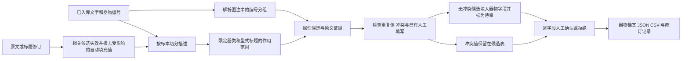

# 器物属性抽取与增量补填工作流

## 补足的环节

原流程识别了器物编号，也把部分尺寸、材质、器类保存为独立实体，但没有把属性绑定到具体器物。新增流程在现有文字和编号索引之上运行，不需要重新扫描 PDF 或执行 OCR。



## 字段和证据约定

| 字段 | 填充依据 | 处理规则 |
|---|---|---|
| `artifact_type` | 标本所属器类标题或明确对应的图注 | 不从邻近其他器物的名称推断 |
| `typology` | 最近的型式标题或图注中的明确分组 | 器类改变后清除旧型式；型式范围不作为单个型式 |
| `material` | 明确写出的青白瓷、白瓷、陶器、青铜等 | “白胎”“青白釉”本身不能证明材质 |
| `period` | 描述中明确的制作、烧造年代或年代断言 | 不把发掘年份、出版年份、章节时代直接赋给器物 |
| `decoration` | 该标本描述中的纹饰原文 | 保留部位、技法及“疑似”等不确定表达，不强制归并为统一纹样标签 |
| `measurements` | 属性名称、数值和单位的组合 | 区分高、残高、通高；处理组末共享单位；统一换算为厘米并保留原文 |

尺寸保存示例：

```json
{
  "足径": {"value": 6.0, "unit": "cm"},
  "残高": {"value": 5.0, "unit": "cm"}
}
```

每个字段候选保留器物 ID、文献 ID、页面 ID、PDF 页序、印刷页码、文本块 ID、字符起止位置、原文、坐标、来源文本哈希、抽取方法和模型名称。标题提供属性时，编号证据和标题证据分别保存。

## 候选与审校状态

新增 `artifact_attribute_candidates` 表保存字段级断言；不修改原始 OCR。`artifacts.metadata.attribute_workflow.fields` 记录每个填充字段的状态与候选 ID。

| 状态 | 含义 |
|---|---|
| `pending` | 自动候选。无冲突时可作为待审值填入器物字段 |
| `approved` | 审校者明确确认的字段断言 |
| `rejected` | 已拒绝；再次运行不会恢复为待审 |
| `stale` | 来源文字或标题改变，原断言失效 |
| `conflict` | 同一字段存在不同候选值，暂不自动填入 |
| `approved_with_conflict` | 保留已审值，同时显示新出现的冲突 |
| `external_value` | 字段已有非本工作流管理的填写，保留原值 |

尺寸按各自名称独立检查冲突；纹饰按原文短句保留集合。重复运行复用候选，不重复增加审校任务。已有人工填写不被自动覆盖。不同 Work 的同号器物不自动合并；跨卷索引按来源分别展示属性。

审校同时检查页面版本与器物版本，避免不同来源页面上的并发审校互相覆盖。原文修订会使相关候选失效；修改共享标题也会影响引用该标题的其他页候选。字段确认、拒绝、来源失效和回写均保留修订记录。

## 已有数据库的增量运行

先查看只读预览：

```powershell
.venv\Scripts\python.exe scripts/enrich_artifacts.py --library data/processed/library --dry-run
```

规则抽取与待审字段补填：

```powershell
.venv\Scripts\python.exe scripts/enrich_artifacts.py --library data/processed/library
```

命令在任何表初始化或数据写入之前，用 SQLite backup API 生成并校验 `backups/before-attributes-*.db`。每份文献在一个事务中写入。重复运行不会重复导入 PDF 或 OCR。

可用 `--manifest ID` 指定文献，用重复的 `--scan-index N` 限定 PDF 页序。例如：

```powershell
.venv\Scripts\python.exe scripts/enrich_artifacts.py --manifest 38ef9921-7ae9-4b56-ab6a-1e887a68b1c3 --scan-index 119 --scan-index 178 --scan-index 354
```

只保存候选、不新增器物字段填充值：

```powershell
.venv\Scripts\python.exe scripts/enrich_artifacts.py --manifest ID --candidates-only
```

如果此前的自动填充值因来源变化已经失效，即使使用候选模式，也会先撤去失效值。

## 有界模型补充

规则阶段不调用外部 API。需要模型处理时显式启用：

```powershell
.venv\Scripts\python.exe scripts/enrich_artifacts.py --manifest ID --models --max-model-units 5
```

默认优先使用已安装本地模型。指定 `--provider cloud` 可使用外部配置中已经启用的接口。模型仍服从 `MAX_CLOUD_CALLS_PER_DOCUMENT`、`MAX_CLOUD_TOKENS_PER_DOCUMENT` 限制，按文献缓存结果及用量，不将密钥写入输出。

输入是一件标本的描述及限定标题，不包含整页其他标本。输出必须通过 JSON 结构、目标编号、逐字证据、尺寸名称、数值和单位校验，才能进入候选表。模型失败保留规则结果并建立核验任务。模型通过出处校验不等于通过语义评测。

校验以字段为单位：合格项入库，不合格项记录在 `rejected_attributes` 中并进入核验队列。型式定义只有出现明确标题分隔符时，才可将“Cg型：……”规范为“Cg型”；瓷类名称的“器”字词尾统一处理，原文证据保留。数值 `5` 和 `5.0` 视为相同值，避免规则与模型产生格式性冲突。

## 查看与人工确认

重启阅览服务加载新代码。在“跨卷器物联动档案”中点击“属性与证据”，按来源卷查看器类、型式、材质、年代、纹饰和尺寸。每项候选可定位原页，填写审校人及依据后确认或拒绝。页面审校列表中的属性任务也会打开这个界面。

接口：

- `GET /api/artifact?id=ARTIFACT_ID`：字段、状态、候选、证据及版本号。
- `GET /api/artifact?candidate=CANDIDATE_ID`：从审校候选打开同一器物档案。
- `POST /api/review`：传入 `task_id`、`actor`、`note`、`status`、`expected_revision` 和 `expected_artifact_revision`。版本过期或证据失效返回冲突。

## 导出与运行记录

每份文献原有运行目录新增：

- `artifacts.json`：器物字段、逐字段审校状态及候选 ID。
- `artifact_attribute_candidates.csv`：字段候选、方法、状态及完整证据，可用于组员核验。
- `artifact_attribute_stage.json`：本次规则阶段统计及备份位置。
- `artifact_model_stage.json` 和 `artifact_model_cache/`：可选模型阶段记录与缓存。

全库汇总写入 `data/processed/library/artifact_attribute_summary.json`。新导入和复用文献的主流程也会执行规则属性阶段，并在常规导出中输出器物数据。

## 适用边界

跨页描述、多个编号共享一段描述、复杂型式范围、不在受支持尺寸词表中的量测仍需扩展规范或人工处理。章节年代不直接等于器物制作年代，因此 `period` 可能继续为空。图版未记载的尺寸不会凭同号跨文献自动补入。当前产出是带证据的待审数据，不是已经完成双人标注的 Gold Standard。

## 验证

```powershell
.venv\Scripts\python.exe -m pytest tests/test_artifact_attributes.py -q
.venv\Scripts\python.exe -m pytest tests -q
.venv\Scripts\python.exe scripts/verify_artifact_attributes.py --baseline data/processed/library/backups/补填前快照.db
```

回归覆盖多标本隔离、共享单位、范围与换算、标题作用域、图注分组、同号跨遗址隔离、已有字段保护、冲突处理、审校版本、来源失效、拒绝后重跑、只读预览、导出同步及真实原文样本。

2026年11月6日的实际运行规模、来源一致性核查和边界见 [运行记录](../reports/artifact_attribute_workflow_summary_2026-11-06.md)。
